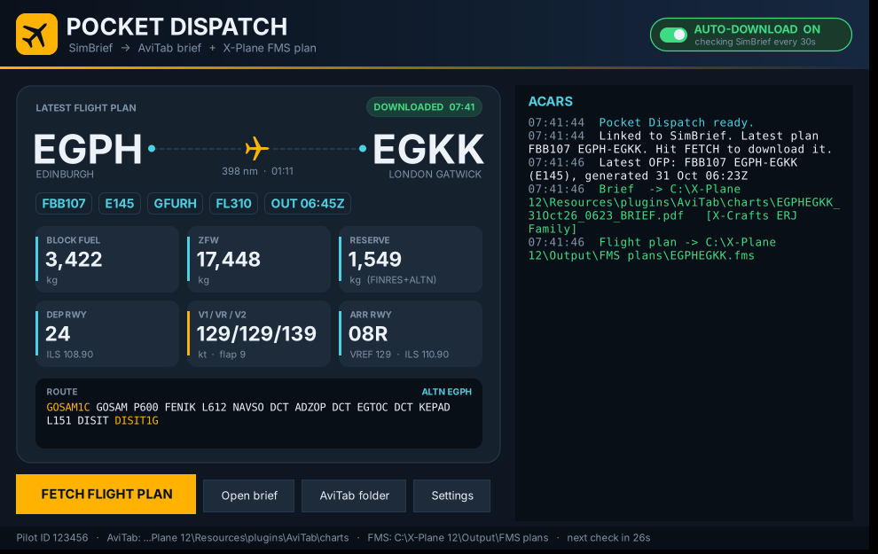

# Pocket Dispatch (.NET 8)

*The dispatcher's paperwork, trimmed down to fit your AviTab.*



See a [sample brief](docs/sample_brief.pdf) and the [settings window](docs/settings.png).

Pocket Dispatch replaces the SimBrief Downloader. It gets your latest SimBrief flight plan, then:

1. **makes a two-page landscape brief** and saves it in AviTab's charts folder (`X-Plane\Resources\plugins\AviTab\charts`)
   - page 1, FMS setup: Init, Route, Fuel/Weight, Take-off, Arrival, Clearance, Weather now
   - page 2, in flight: a nav log with boxes for times and fuel, key numbers, TAFs, and the airport NOTAMs that matter
2. **downloads the X-Plane `.fms` flight plan** to `X-Plane\Output\FMS plans`, named like `EGPHEGKK.fms`.

All figures come straight from SimBrief's flight-plan data (the same feed the aircraft use for import), so nothing depends on the PDF layout. It needs no extra packages: the PDF is written by built-in code.

## Build

You need the [.NET 8 SDK](https://dotnet.microsoft.com/download/dotnet/8.0) (or Visual Studio 2022 with ".NET desktop development"). Run these from the folder that contains `PocketDispatch.sln`:

```bat
dotnet publish src\PocketDispatch.App -c Release -r win-x64 --self-contained false -p:PublishSingleFile=true -o publish
```

`publish\PocketDispatch.exe` is the Windows app. This build needs the .NET 8 Desktop Runtime installed, which comes with the SDK.

To make an exe that runs on a PC **without** .NET installed (it's larger), use:

```bat
dotnet publish src\PocketDispatch.App -c Release -r win-x64 --self-contained true -p:PublishSingleFile=true -o publish
```

Optional command-line version (`pdispatch.exe`):

```bat
dotnet publish src\PocketDispatch.Cli -c Release -r win-x64 --self-contained false -p:PublishSingleFile=true -o publish
```

MSBuild or Visual Studio also work: open `PocketDispatch.sln` and build in Release, or run `msbuild PocketDispatch.sln -restore -p:Configuration=Release`.

## Use

1. Run `PocketDispatch.exe`. The first time, **Settings** opens: enter your **SimBrief Pilot ID** (simbrief.com > Account Settings) and your **X-Plane folder**. Leave the AviTab and FMS folders blank to use the standard locations.
2. The **flight card** shows the latest plan on SimBrief: the route, callsign, fuel, ZFW, reserve, runways and V-speeds.
3. Hit **FETCH FLIGHT PLAN**, or switch the **AUTO-DOWNLOAD** pill on and leave the app in the system tray. Every flight plan you generate on SimBrief is picked up within about 30 seconds, and a notification pops up. The **ACARS** panel logs what was saved where.
4. Turn off the old SimBrief Downloader so you don't get duplicates.

Other options (in Settings):
- **A5 pages:** the text looks bigger on the AviTab screen.
- **Also save SimBrief's full PDF:** keeps the complete OFP next to the brief.
- **Aircraft layout:** detected automatically from the aircraft type (ERJ, ToLiSS Airbus, Q400, or Generic). You can force one here.

Command line: `pdispatch` fetches once, `pdispatch --watch` keeps watching, `pdispatch --setup` asks for your details, and `pdispatch --xml saved.xml -o brief.pdf` builds a brief from a saved SimBrief XML file. It shares settings with the Windows app.

## Settings and aircraft layouts

Both files live in `%APPDATA%\PocketDispatch\`. Settings from the earlier SimBriefBrief build are copied across automatically.

- `settings.json`: your Pilot ID, folders and options. You can also change `WatchSeconds` and `FmsFormats` here. `FmsFormats` takes SimBrief format codes; `xpe` is the X-Plane 11/12 `.fms` format.
- `profiles.json`: the rows shown for each aircraft. It's created the first time the app runs; **Settings > Edit aircraft layouts** opens it. Each row is `["Field", "Entry"]`:
  - `{key}` inserts a value, and `{key|text}` uses `text` when the value is missing
  - `____` makes a yellow write-in box
  - a field starting with `!` is printed large

  To go back to the defaults, delete the file.

Available keys:

| Area | Keys |
|---|---|
| Init | dep, arr, altn, callsign, flight, reg, type, cruise_fl, cruise_speed, cost_index, tropo, isa, avg_wind, trip_wind |
| Route | sid, enroute, star, route, to_rwy, ld_rwy |
| Fuel / weights | block_f, taxi_f, trip_f, cont_f, altn_f, finres_f, reserve_f (FINRES+ALTN), tof_f, ldg_fuel_f, zfw_f, tow_f, law_f, max_zfw_f, max_tow_f, max_law_f, pax, wu (kg/lb) |
| Take-off | to_len, len_unit, to_ils, to_flap, to_thrust, to_flex, to_maxtemp, to_v1, to_vr, to_v2, to_vother, to_vother_id, to_oat, to_wind, to_qnh |
| Landing | ld_len, ld_ils, ld_flap, ld_vref, ld_dry, ld_wet, ld_dry_fact, ld_wet_fact, ld_surface |
| Airport | dep_ta, arr_tl |

## Notes
- Take-off and landing figures need **Runway Analysis** switched on when you generate the flight plan on SimBrief.
- Runway lengths and landing distances are shown in m or ft. The unit is guessed from the size of the figure, because SimBrief follows your own settings.
